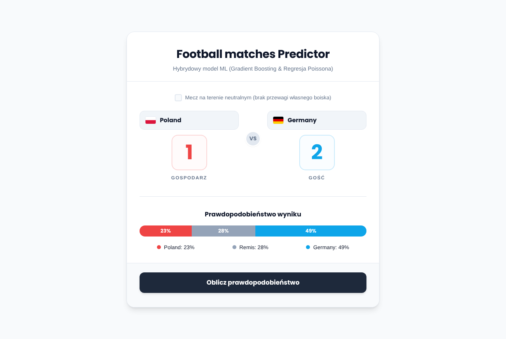
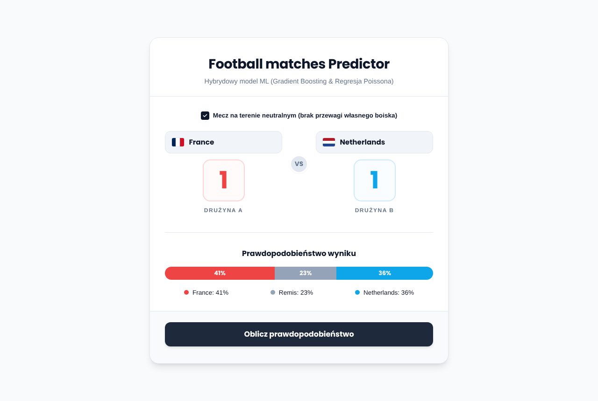
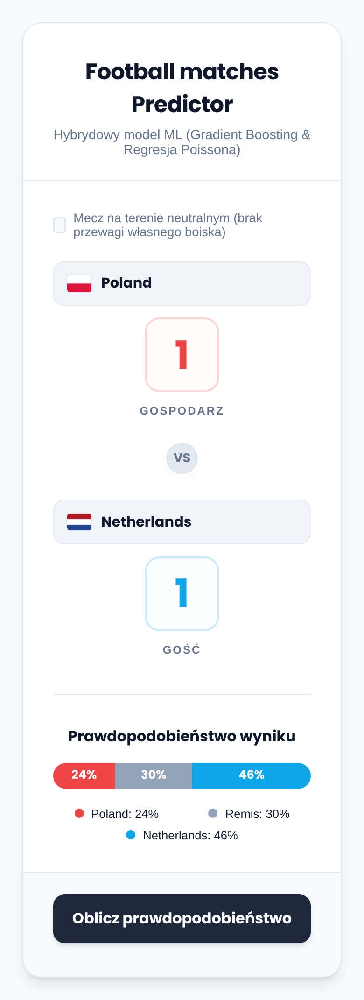

# Football Match Predictor

[Polski](README.md) · **English**

> Who wins, how many goals, and how sure we are about it.

A web app and API that predicts results of national team matches. Pick two teams and the model gives the
probability of each team winning, the chance of a draw and the most likely score. It learns from over 48,000
international matches since 1872 and from the history of the FIFA ranking.

There are two models under the hood: a calibrated Gradient Boosting classifier for the 1X2 outcome and two
Poisson regressions for home and away goals. The backend is FastAPI, the frontend is plain HTML, CSS and
JavaScript with no framework.



## Who it is for

- **Football fans** who want to see how history and form rate their team's chances, e.g. before the 2026
  World Cup.
- **People learning machine learning** - a complete example from raw CSV through feature engineering and a
  chronological split to a model served by an API.

What it is **not**: a betting tool. About 59% accuracy on 2025 matches is a good result for football, but
football stays very random.

## How it works

```
results.csv + fifa_ranking.csv (Kaggle)
   │
   ▼
verify_data.py   checks and cleans the data
   │
   ▼
data_prep.py     attaches the FIFA ranking, computes form and head-to-head record
   │
   ▼
train.py         trains on matches before 2025, tests on matches from 2025-2026
   │
   ▼
main.py          FastAPI: /api/teams, /api/predict and the web page
```

**Match features** (9 per match):

| Feature | What it measures |
|---|---|
| weighted form of both teams | points from the last 100 matches, recent matches weigh more (exponential decay) |
| FIFA rank of both teams and the difference | ranking position as of the day before the match |
| head-to-head record | home win rate and average goal difference in matches between these two teams |
| goals in the last 5 matches | average goals scored by each team |

All features are computed only from matches played earlier, so the model never sees the future.

**Neutral ground** - when checked, the model runs the match from both sides (A at home and B at home) and
averages the results to remove home advantage.

## Results

Tested on 1,408 matches since January 1, 2025, trained on 46,783 earlier matches:

| Model | Metric | Result |
|---|---|---|
| Gradient Boosting (1X2) | accuracy | 59.2% |
| Gradient Boosting (1X2) | log-loss | 0.902 |
| Poisson - home goals | MAE | 1.12 |
| Poisson - away goals | MAE | 0.92 |

The most important features according to the model: average head-to-head goal difference and the weighted
form of both teams.

## Screenshots

| Neutral ground | Phone |
|---|---|
|  |  |

The interface is in Polish.

## Getting started

Requires Python 3.10 or newer.

1. Install dependencies:
   ```bash
   pip install -r requirements.txt
   ```
2. Download `results.csv` (international match results) and `fifa_ranking.csv` (FIFA ranking history) from
   Kaggle and put them in the `data/` folder.
3. Prepare the data and train the models:
   ```bash
   python src/verify_data.py
   python src/data_prep.py
   python src/train.py
   ```
4. Start the server:
   ```bash
   python main.py
   ```
   The app runs at [http://localhost:8000](http://localhost:8000).

## API

| Method | Path | What it does |
|---|---|---|
| `GET` | `/api/teams` | List of teams in the historical data |
| `POST` | `/api/predict` | Match prediction |

Example:

```bash
curl -X POST http://localhost:8000/api/predict \
  -H "Content-Type: application/json" \
  -d '{"team1": "Poland", "team2": "Germany", "neutral": false}'
```

```json
{
  "status": "success",
  "matchup": { "home_team": "Poland", "away_team": "Germany", "neutral": false },
  "probabilities": { "team1": 23, "draw": 28, "team2": 49 },
  "predicted_score": { "team1": 1, "team2": 2 }
}
```

Interactive FastAPI docs are available at `/docs`.

## Structure

```
src/
  verify_data.py   data checks and cleaning
  data_prep.py     FIFA ranking, form, head-to-head record
  train.py         training and evaluation
static/            frontend (HTML, CSS, JavaScript)
main.py            FastAPI server
data/              CSV files (not in git)
models/            trained .joblib models (not in git)
docs/screenshots/  README screenshots
```

## License

[MIT](LICENSE) © 2026 Szymon Kaczmarczyk

The Kaggle datasets have their own licenses, check them on the dataset pages. Flags in the interface come from
[flagcdn.com](https://flagcdn.com).
